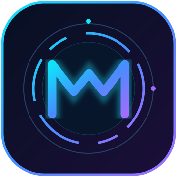
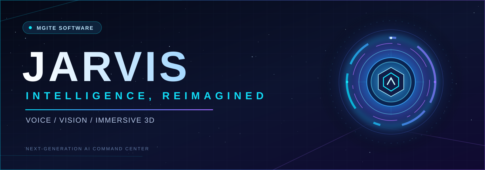
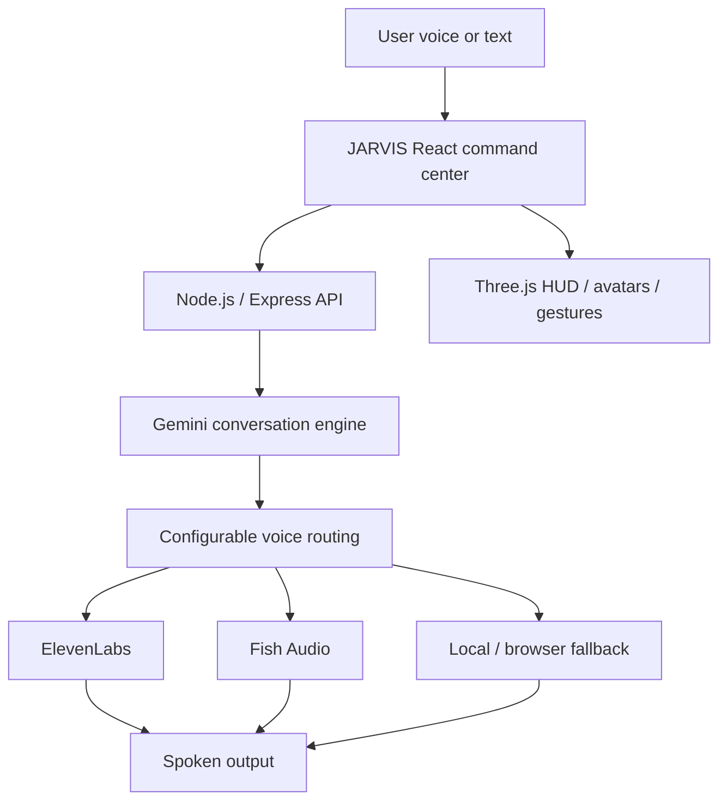

<div align="center">

  

  <h3>MGITE SOFTWARE</h3>
  <p><strong>Independent AI & immersive software experiments</strong></p>

  

  <h1>JARVIS AI</h1>
  <p><strong>Speak naturally. Think intelligently. Interact beyond the screen.</strong></p>
  <p>A modular AI assistant experiment combining conversation, voice, and cinematic 3D interactions.</p>

  <a href="https://github.com/MohitLovanshi372/mgite-software/stargazers"></a>
  <a href="https://github.com/MohitLovanshi372/mgite-software/forks"></a>
  <a href="LICENSE"></a>
  

  <br/><br/>
  
  
  
  
  

  <p>
    <a href="#-explore-the-system">Explore</a> &nbsp;·&nbsp;
    <a href="#-getting-started">Get started</a> &nbsp;·&nbsp;
    <a href="#-architecture">Architecture</a> &nbsp;·&nbsp;
    <a href="#-roadmap">Roadmap</a>
  </p>

</div>

---

## 🌌 Welcome to the command center

**JARVIS AI** is an experimental personal assistant project by **MGITE SOFTWARE**. It brings together a conversational AI backend, configurable text-to-speech providers, reactive HUD elements, 3D visuals, and hands-free interaction prototypes.

The goal is a responsive, expressive assistant that feels like a unified workspace rather than a plain chatbot.

> [!NOTE]
> This repository contains both implemented modules and features still being developed. A module existing in the source code does **not** mean its end-to-end behavior is verified on every computer.

## ✨ Explore the system

| 🧠 **THINK** | 🎙️ **SPEAK** | 🌐 **INTERACT** |
|:---|:---|:---|
| Gemini AI backend | ElevenLabs provider | Animated AI HUD |
| Conversation routing | Fish Audio provider | React + Three.js scenes |
| Context and task modules | Browser voice fallback | Gesture interface components |
| Intent and security helpers | Hindi/Hinglish processing | Avatar & command center UI |

### Built for experimentation

- **Neural conversation** — Google Gemini integration and modular AI orchestration.
- **Voice-first interface** — configurable TTS providers, speech normalization and listening/speaking states.
- **Immersive visuals** — animated core, avatars, galaxy scenes, status panels and telemetry UI.
- **Gesture prototyping** — camera and MediaPipe components for hand-tracking experiments.
- **Privacy-aware utilities** — permission and privacy filtering modules for sensitive operations.

## 🖥️ Interface and demos

A polished dashboard deserves real proof, not placeholder screenshots. **Actual JARVIS screenshots and a demo recording are planned**; they will be added here after being captured from a working build.

<details>
<summary><strong>See the interface modules currently present in source</strong></summary>

- <code>src/components/HUD</code> — AI core, radar and instrument panels.
- <code>src/components/Avatar</code> — interactive character stage.
- <code>src/components/Galaxy</code> — three-dimensional space scene.
- <code>src/components/Gestures</code> — gesture calibration and overlays.
- <code>src/components/Layout</code> — navigation and command-console components.

</details>

## 🧩 Technology stack

| Area | Stack |
|:---|:---|
| Frontend | React 19 · TypeScript · Vite |
| Visual design | Tailwind CSS · Lucide · Motion |
| 3D | Three.js · React Three Fiber · Drei |
| AI | Google Gemini |
| Voice | ElevenLabs · Fish Audio · Web Speech |
| Backend | Node.js · Express · WebSocket |
| Speech microservice | Python |
| Camera gestures | MediaPipe |

## 🔀 Architecture



> VoiceStudio local speech support is being evaluated as an **optional future provider**. It should not be treated as an existing, tested integration until the adapter and playback are verified.

## 🚀 Getting started

**Prerequisites:** Node.js, npm and a modern browser. Cloud AI and voice functions require the relevant provider credentials. Python is needed only for Python-based services.

For Windows PowerShell:

```powershell
git clone https://github.com/MohitLovanshi372/mgite-software.git
cd mgite-software
npm install
Copy-Item .env.example .env
```

Edit `.env` **on your own computer** and set only the credentials for services you plan to use. Never put keys in your commits or screenshots.

```powershell
npm run dev
```

Open **http://localhost:3000** once the server has started. Voice output requires an additional end-to-end playback check; build success alone does not confirm audio works.

<details>
<summary><strong>AI and voice configuration example (no real credentials)</strong></summary>

```dotenv
AI_PROVIDER=gemini
AI_MODEL=YOUR_AVAILABLE_GEMINI_MODEL
GEMINI_API_KEY=YOUR_PRIVATE_KEY
TTS_PROVIDER=elevenlabs
ELEVENLABS_API_KEY=YOUR_PRIVATE_KEY
ELEVENLABS_MODEL=eleven_multilingual_v2
ELEVENLABS_VOICE_ID=YOUR_VOICE_ID
VOICE_ENABLED=true
AUTO_SPEAK=true
```

</details>

## 🧪 Development

```powershell
npm run lint
npm run build
npm test
```

If you are developing the Python voice bridge on Windows, confirm the Python executable is available and review its local integration settings.

## 🛸 Roadmap

- [ ] Verify Gemini voice conversations and real ElevenLabs playback end-to-end.
- [ ] Improve natural Hindi/Hinglish pronunciation and response latency.
- [ ] Test a separate VoiceStudio local TTS adapter and model licensing.
- [ ] Validate wake-word and gesture interactions on real hardware.
- [ ] Expand permission-controlled desktop automation.
- [ ] Publish real screenshots, a short demo, and CI checks.

## 🤝 Contributing

Questions, focused bug reports and reproducible pull requests are welcome. Include your OS, the steps to reproduce, expected behavior and any relevant logs **without API keys or personal information**.

## 📜 License and credits

This project is licensed under the [MIT License](LICENSE). The project branding, visuals and repository showcase are original to **MGITE SOFTWARE**.

Third-party frameworks and optional speech engines keep their respective licenses. **VoiceStudio is a separate AGPL-3.0 project**; its code is not included in this repository by this README design.

---

<div align="center">

  <h3>MGITE SOFTWARE</h3>
  <p><strong>Make intelligence feel alive.</strong></p>
  <p>Built with curiosity · Powered by experimentation · Designed for the next interface</p>
  <p>⭐ If you find JARVIS interesting, give the repository a star.</p>

</div>
